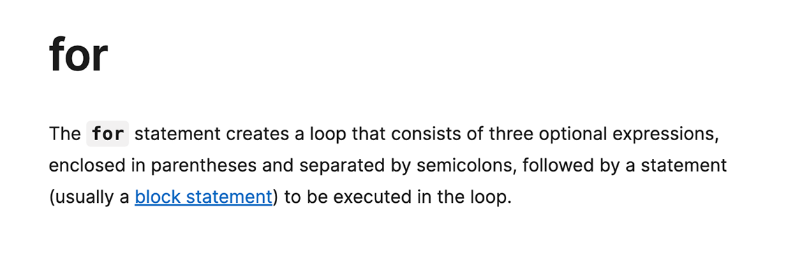
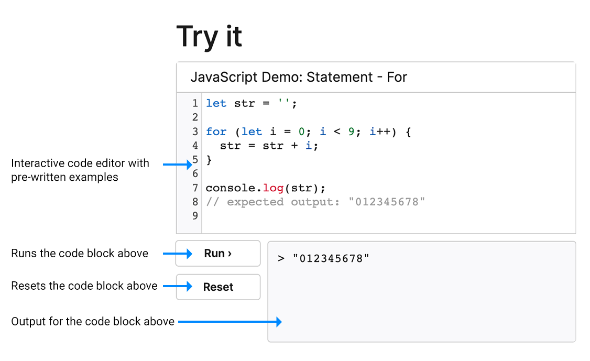
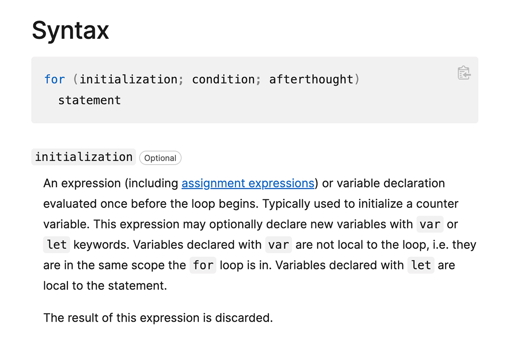
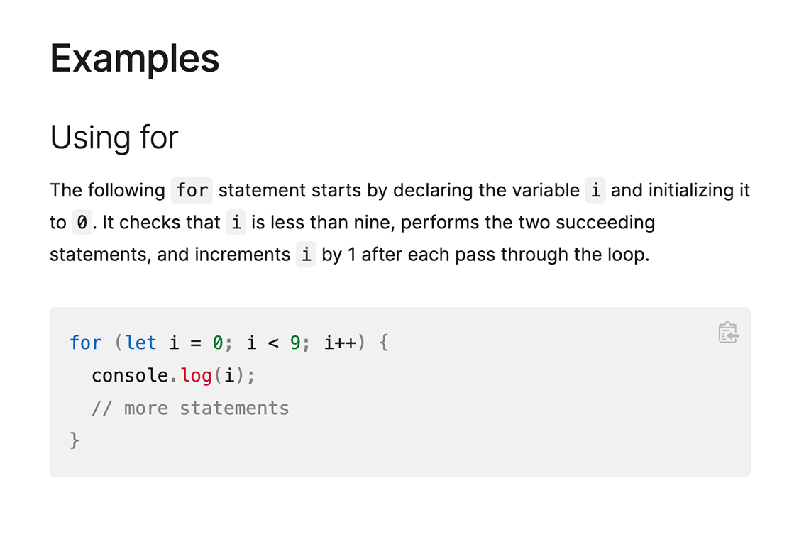
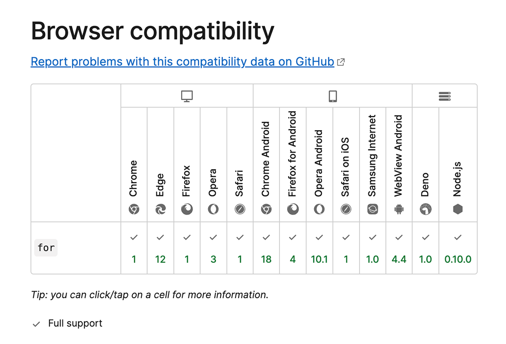
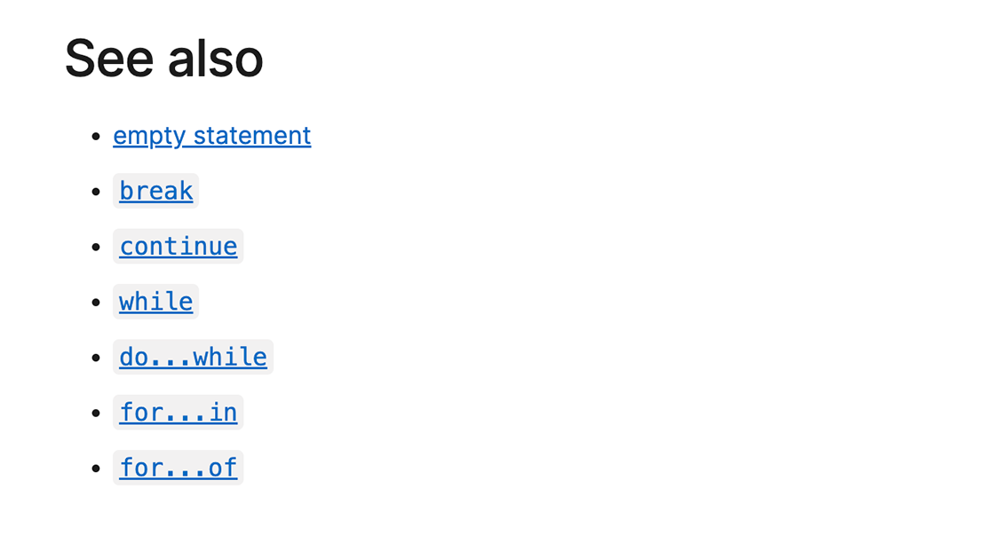
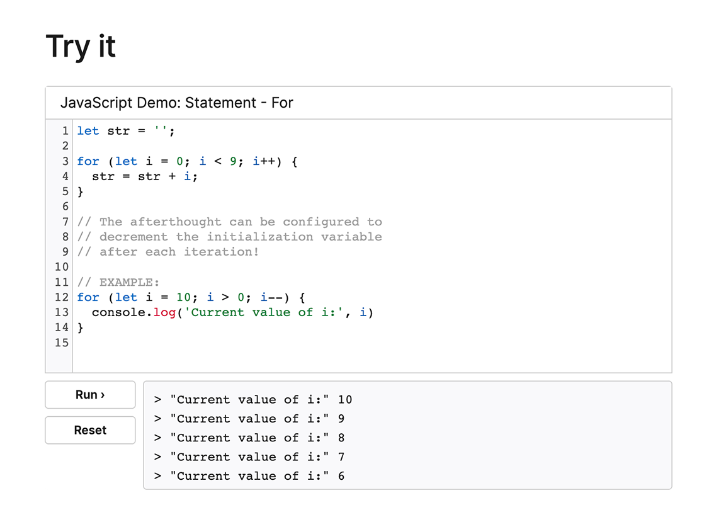

# Intro to MDN - Anatomy of an MDN Article

tktk - Hunter, replace the assets of screen shots with ones with a dark OS per our style guide

**Learning objective:** By the end of this lesson, students will be able to better understand the basics of how each topic is presented in MDN which should better assist them in answering questions about and solving problems with said topic.

## How to read documentation

Reading documentation is a skill. It will take time and practice to feel comfortable with the process. MDN is a fantastic reference for material that you have a working awareness of, but it might be an intimidating starting point for new concepts.

MDN articles use a lot of technical jargon. As a new developer, you’ll often need to put forth a bit of time and effort to properly engage with the material. Don’t expect yourself to understand a topic based on the summary section alone. 

When using an MDN article, cross reference the summary with the syntax section and provided examples. Once you’ve formulated a working understanding, put it to the test in the MDN provided code editor section or VS Code.

> 💡 You’ll often see the term [prototype](https://developer.mozilla.org/en-US/docs/Learn/JavaScript/Objects/Object_prototypes) used in the title of various MDN articles.You can ignore this for now. We’ll dive into this concept in more detail next week. For now, when you see something like Array.prototype, that just means that particular method is available anytime you are working with an array in Javascript. 

## Breakdown of articles

In this section we’ll get some practice with MDN by breaking down the anatomy of an article. We’ll be using the [documentation on for loops](https://developer.mozilla.org/en-US/docs/Web/JavaScript/Reference/Statements/for) in this walkthrough. 

### Summary

At the top of every MDN article you’ll find a brief summary of the subject. Documentation can be overwhelming and confusing at first, but it gets easier with time and is indescribably helpful. The terminology used here is often addressed in the Syntax/Parameters section, so do your best to cross reference these areas until you have an adequate understanding of the concept.

### Try it

Below the summary you’ll see an interactive **Try it** section with a mini code editor. This section is great for hands on learning. You’ll usually be able to get a general sense of how something works from the **Summary** and **Try it** sections. The code editor here will often feature a very basic, pre-written implementation of the article subject. Feel free to play around with the code, as you can reset it if needed. Checkout the screenshot below for some notes on how the editor works.

### Syntax/Parameters

Next you’ll see a section on the subject’s syntax and parameters. This will provide you with some great context on what you’ve seen in the previous two sections. You’ll often need to jump back and forth between this section and the summary as you build your understanding, especially when it comes to technical jargon. The information here is also a great way to improve your coding vocabulary.

### Examples

Next you’ll see a fairly lengthy section with various examples. Don’t get intimidated by the amount of content here. The first example is usually the most basic use case for the subject, so feel free to keep your focus on that. Try doing a quick scan of the other titles in the **Examples** section. Make a mental note of anything that sounds particularly interesting. You might want to return to these once you are more comfortable with the basics.

### Browser compatibility

The next section indicates what browsers and runtime environments the article subject is compatible with. Every now and then you might stumble upon a newer piece of content that is not fully supported. The **[at() method](https://developer.mozilla.org/en-US/docs/Web/JavaScript/Reference/Global_Objects/Array/at#specifications)** for example only gained full support amongst browsers and runtimes recently. You won’t need to worry about browser compatibility with the content taught in this course, but be aware of this issue as you dive deeper into Javascript. You might find yourself with a job where your application is required to support older browsers.

### See also

The last section here offers links to related content. This is a great resource for structuring any self-learning you do during this course. These links to articles on other looping methods would be an excellent next step after you feel comfortable with basic `for` loops.

## Taking notes

Once you have a decent understanding of the material, you’ll likely want to jot down some notes to reference later. The **Try it** section is great for note taking as you work through an article, but you’ll need to paste this into a `.js` file on your computer if you want to come back to it. Keep your notes in a single directory, and title each `.js` file with the article subject. 

You can see an example of the kinds of notes you might take in the screenshot below.

> 💡 When taking notes on technical material, always try to break down a concept in your own words. This will help you build your understanding and make reviewing easier!