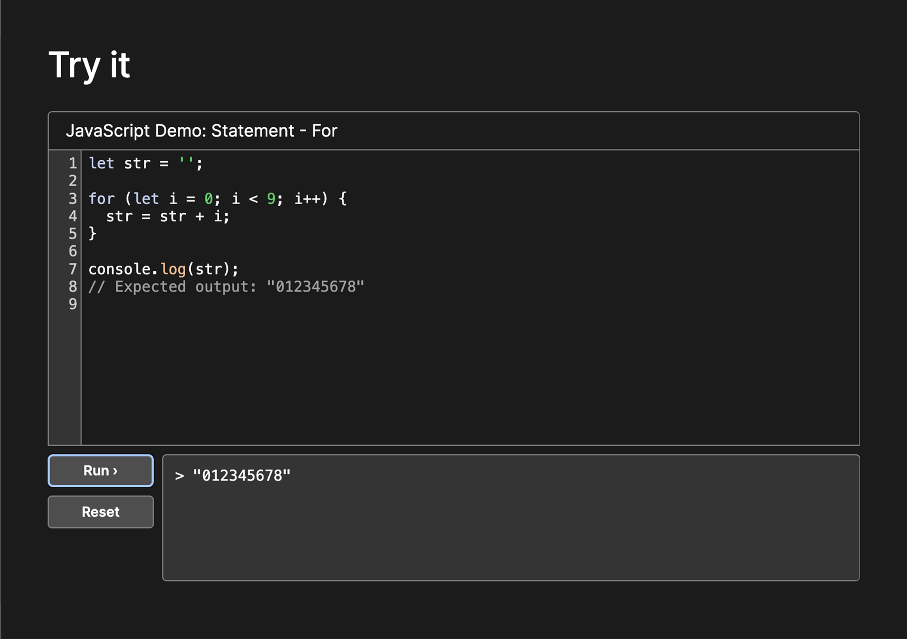
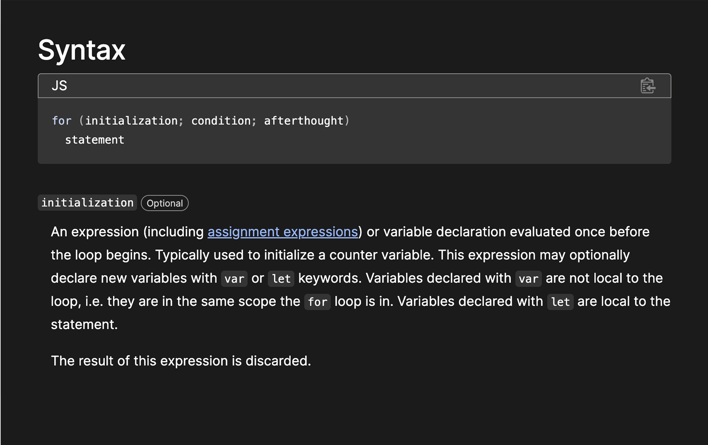
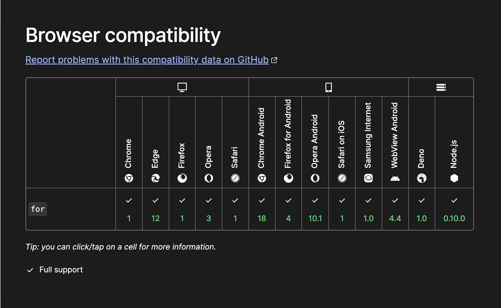
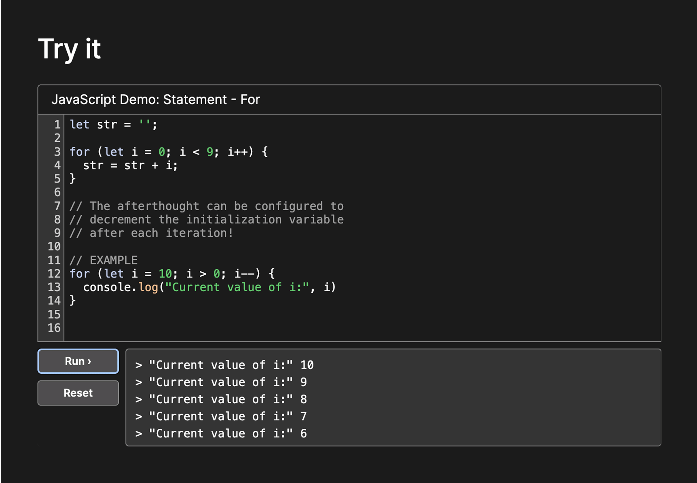

<h1>
  MDN
  Anatomy of an Article
</h1>

**Learning objective:** By the end of this lesson, students will be able to effectively navigate and experiment with the different sections of MDN Web Docs articles.

## How to read documentation

Reading documentation is a skill. It will take time and practice to feel comfortable with the process. MDN is a fantastic reference for material that you have a working awareness of, but it might be an intimidating starting point for new concepts.

MDN articles often contain technical terms and concepts. As a new developer, you’ll need to put in a bit of time and effort to properly engage with the material. Don’t expect yourself to understand a topic based on the summary section alone.

A good approach is to read the summary, then look at the syntax section, which explains how the code is structured, and check the examples given. These examples show how the code is used in real situations. After you think you understand the concept, try writing and testing code either in the MDN's built-in code editor or in a coding environment like VS Code. This hands-on practice is key to solidifying your understanding.

> 💡 You’ll often see the term [prototype](https://developer.mozilla.org/en-US/docs/Learn/JavaScript/Objects/Object_prototypes). In JavaScript, 'prototype' is a concept that deals with the language's underlying structure. It's important to know that you don't need a deep understanding of JavaScript objects to use methods related to prototypes. Simply put, even if you're just beginning with JavaScript, you can still apply these prototype methods effectively.

## Breakdown of articles

In this section we’ll get some practice with MDN by breaking down the anatomy of an article. We’ll be using the [documentation on `for` loops](https://developer.mozilla.org/en-US/docs/Web/JavaScript/Reference/Statements/for) in this walkthrough. 

### Summary

At the beginning of each MDN article, there's a short summary that gives an overview of the topic. Often, the technical terms introduced in the summary are explained in more detail in the "Syntax/Parameters" section of the article. It's helpful to compare these two sections as you work towards understanding new concepts being introduced.

### Try it

Below the summary you’ll see an interactive **Try it** section with a mini code editor. This section is great for hands on learning. You’ll usually be able to get a general sense of how something works from the **Summary** and **Try it** sections. The code editor here will often feature a very basic, pre-written implementation of the article subject. Don't be afraid to alter and experiment the code here, you can always reset it if needed. Checkout the screenshot below for some notes on how the editor works.

### Syntax/Parameters

Next, you'll find a section detailing the subject's syntax and parameters. This section offers valuable context that complements what you've learned in the previous two sections. You’ll often need to jump back and forth between this section and the summary as you build your understanding, especially when it comes to technical jargon. The information provided here is an excellent resource for improving your technical vocabulary.

### Examples

Next you’ll see a fairly lengthy section with several examples. Don’t get intimidated by the amount of content here. The first example is usually the most basic use case for the subject, focus your attention there. Try quickly scanning the other titles in the **Examples** section. Make a mental note of anything that sounds relevant or interesting. You might want to return to these once you are more comfortable with the basics.

### Browser compatibility

The next section indicates what browsers and runtime environments are compatible with the featured topic. Occasionally, you may find newer features that aren't yet widely supported. The array**[at() method](https://developer.mozilla.org/en-US/docs/Web/JavaScript/Reference/Global_Objects/Array/at#specifications)** for example, only recently achieved broad compatibility. In your future career, you may need to ensure that the applications you develop are compatible with older browsers.

### See also

The final section of the article includes links to related topics. These links are valuable for guiding future self-study as you progress in your skills. For example, after you've become comfortable with basic `for` loops, the linked articles about other looping methods can serve as an excellent resource for advancing your knowledge.

## Taking notes

Once you have a basic understanding of the material, it's a good idea to take notes for future reference. The **Try it** section in the article is useful for making notes while you learn. However, to save these notes for later use, you'll need to copy them into a .js file on your computer. 

> **Pro Tip:** Organize your notes by keeping them all in one folder, and name each .js file after the topic it covers. This will help you easily find and review your notes when needed.

You can see an example of the kinds of notes you might take in the screenshot below.

> 💡 When taking notes on technical material, always try to break down complex concepts in your own words. This will help you build your understanding and make reviewing easier!